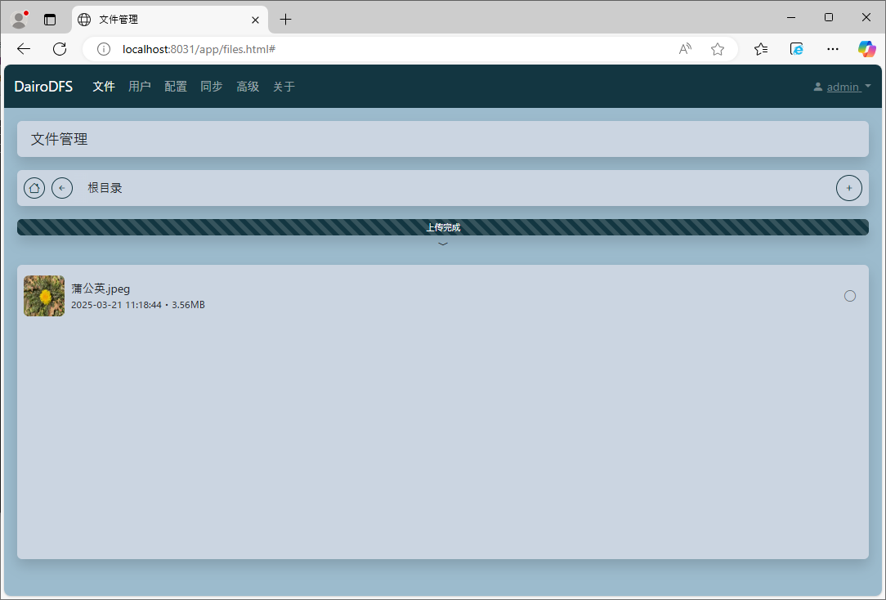

# DairoDFS

# 1. 系统说明

DairoDFS是一个文件存储系统


## 产品特色

### 1). 分布式

支持多端存储、备份，即使其中一台DairoDFS服务器故障，其他DairoDFS服务端也能正常使用，且数据不会丢失。

### 2). 实时性

分布式部署时，集群中的任意一台数据发生变化，会立即同步到其他集群的服务器。

### 3). 高并发

DairoDFS使用Rust语言开发，基于异步IO，即使有大量客户端同时使用，对服务器性能消耗极低。

### 4). 轻量级

DairoDFS使用Rust语言开发，只有一个可执行文件（网页资源已经打包在程序里），安装包小、占用内存低、CPU消耗低，不影响服务器上其他软件的运行。

# 2. 安装
请根据您的操作系统，从[发行版本](https://github.com/DAIRO-HY/DairoDFS/releases)页面，选择合适的版本进行安装（推介安装最新版本）。

## 1). Windows系统

a. 下载后缀为.exe的文件,并保存到您觉得合适的文件夹（不一定是数据存储的文件夹）。<br>
b. 双击刚刚下载的.exe文件即可运行。

## 2). Mac系统

a. 打开Terminal软件<br>
b. 执行以下bash指令

```bash
#创建文件夹
mkdir ~/dairo-dfs

#进入刚刚创建的文件夹
cd ~/dairo-dfs

#下载安装包，其中2.0.0为版本号，请根据实际情况选择您所需要的版本
#Intel芯片请下载 DairoDFS-mac-darwin-amd64-2.0.0
curl -L -o dairo-dfs https://github.com/DAIRO-HY/DairoDFS/releases/download/2.0.0/DairoDFS-mac-darwin-aarch64-2.0.0

#赋予可执行权限
chmod +x dairo-dfs

#启动程序
./dairo-dfs
```

※由于Mac系统安全策略的原因，系统可能会阻止程序运行，请在系统设置里允许程序运行

## 3). Linux系统
执行以下bash指令
```bash
#创建文件夹
mkdir ~/dairo-dfs

#进入刚刚创建的文件夹
cd ~/dairo-dfs

#下载安装包，其中2.0.0为版本号，请根据实际情况选择您所需要的版本
#arm64位系统请下载 DairoDFS-linux-arm64-2.0.0
curl -L -o dairo-dfs https://github.com/DAIRO-HY/DairoDFS/releases/download/2.0.0/DairoDFS-linux-amd64-2.0.0

#赋予可执行权限
chmod +x dairo-dfs

#启动程序
./dairo-dfs
```

## 4). Docker安装(Linux推介)

Docker镜像里已经安装了LibRaw、ImageMagick、ExifTool，FFmpeg可以在安装向导里一键安装。

```bash
docker run -p 8031:8031 -e TZ=Asia/Shanghai -v ./data:/app/data dairopapa/dairo-dfs:2.0.0
```

镜像支持amd64和arm64。
※如果你想通过docker安装，推介使用[docker-compose](./document/build/dfs_dockerfile/docker-compose.yml)部署，
※请通过环境变量`TZ`指定时区，照片的拍摄时间是按服务器的时区计算的。

# 3. 配置
## 1). 安装完成之后，请从浏览器打开[http://127.0.0.1:8031](http://127.0.0.1:8031)。<br>
※其中127.0.0.1是你的服务器ip地址，请根据实际情况输入，:8031是程序默认端口，如需更改端口，请参考启动参数。

## 2). 浏览器打开之后请根据页面提示进行设置。

安装向导共8步：
1. 安装FFmpeg、FFprobe、LibRaw、ImageMagick、ExifTool（用于生成视频、RAW照片、HEIC照片、PSD等文件的缩略图和预览图）。已经安装的会自动检测，没有安装的可以点击"安装"，也可以跳过，跳过之后只影响对应格式文件的处理。
2. 设置文件存储目录。
3. 设置分布式同步（可跳过）。设置之后会立即从主机同步所有数据，同步完成之后直接使用主机的账号登录。
4. 创建管理员账号。

# 4. 启动参数
程序启动时，如需更改默认配置，可以通过以下方式进行修改。<br>
例：
```bash
#更改默认端口为80
./dairo-dfs --web-port 80
```

| 参数 | 环境变量 | 默认值 | 说明 |
|---|---|---|---|
| `--web-port` | `DAIRO_DFS_WEB_PORT` | 8031 | 程序监听端口，老版本的`--port`参数也可以继续使用 |
| `--data-dir` | `DAIRO_DFS_DATA_DIR` | ./data | 数据保存目录，数据库、配置文件、默认的文件存储目录都在这个目录下 |
| | `HYPEROUTE_MAX_BODY_SIZE` | 10GB | 上传文件大小上限，例如`512MB`、`20GB` |

# 5. 从老版本(1.x)升级

2.0.0使用Rust重写，升级之前请先备份`data`目录。

1. **数据会自动迁移**：首次启动时，如果`data`目录下只有老版本的数据库`dairo-dfs.sqlite`，程序会把数据复制到新的数据库`dairo-dfs2.sqlite`，老版本的数据库不会被修改。配置文件、存储的文件、已经安装的FFmpeg等工具、分享链接都可以继续使用。
2. **分布式部署时所有服务器要一起升级**：新老版本之间不能互相同步。升级之后请在分机的"同步"页面执行一次"全量同步"。
3. **客户端需要更新**：接口已经改变，老版本的APP需要更新到对应的版本。

# 6. 编译

需要安装[Rust](https://www.rust-lang.org/)（stable版本）。

```bash
#开发时运行(数据保存在项目根目录的data目录下)
cargo run

#编译发布版本
cargo build --release
```

打包脚本都在`document/build`目录下，编译好的程序保存在项目根目录的`build`目录下：

| 脚本 | 说明 |
|---|---|
| `install_cargo.sh` | 在Linux上安装Rust编译环境 |
| `build_dfs.sh` | 通过Docker编译Linux amd64、arm64版本 |
| `build_dfs.mac.sh` | 编译macOS Intel、M芯片版本 |
| `build_dfs_win.sh` | 启动Windows虚拟机，通过`build_dfs_win.bat`编译Windows版本 |
| `build_github.sh` | 创建标签，上传编译好的程序到GitHub的Release（需要环境变量`GITHUB_TOKEN`） |
| `build_dfs_runtime_docker.sh` | 构建并推送Docker运行时镜像（安装了LibRaw、ImageMagick、ExifTool，只在需要更新这些工具时执行） |
| `build_dfs_docker.sh` | 构建并推送Docker镜像（需要环境变量`DOCKER_USER`、`DOCKER_PASSWORD`） |
| `build_all.sh` | 依次执行Linux编译、上传GitHub、推送Docker镜像 |
| `build_all.mac.sh` | 编译macOS版本 |

在Jenkins容器里执行`build_dfs.sh`时，需要通过环境变量`HOST_PROJECT_DIR`、`HOST_CARGO_DIR`指定项目目录和cargo目录在宿主机上的路径。

# 联系我们
若您在使用过程中遇到任何问题,请扫描下方的微信二维码联系我们。


